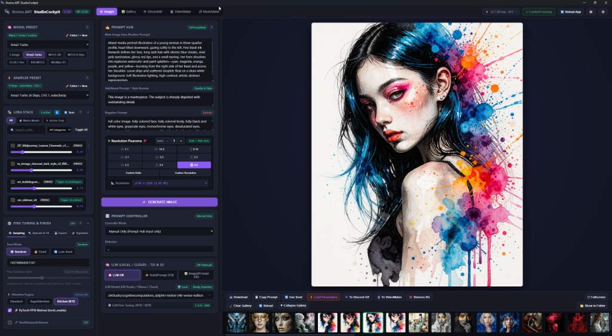

# thomo.ART StudioCockpit (v1.43 - FLEXMOD Edition)

An all-in-one Windows desktop & web studio for AI image generation, media management, animated Discord GIFs, AI video production, and AI music creation — powered by **ComfyUI** and **TA-FLEXMOD-LLM** in the signature **thomo.ART** Studio UI design.



---

## 🧩 Integrated Studio Modules

### 🎨 Image Studio
* **Model & LoRA Hub:** Select model presets (*ZImage*, *Qwen-Image 2.1*, *Krea2-Turbo*, *FLUX3-Klein*, *MOSS-Image*, *FLUX1-DEV-FP8*, *Minimax H3 Image*, etc.) with quick-access favorite pills, plus an integrated LoRA stack with live strength sliders and automatic trigger-word detection.
* **AI Prompt Engine (3-Way):** Switch between `🚫 Manual`, `✨ T2I Booster`, and `🖼️ I2I Analysis` (Vision-LLM + image upload) across `positive`, `additional`, and `negative` prompt channels using local LLMs (LM Studio, Ollama) or optional cloud providers (Gemini, OpenAI, OpenRouter, Groq).
* **Sampling, Upscaling & Overlays:** 1-click sampler & aspect-ratio presets (`16:9`, `1:1`, `9:16`, `4:3`, `21:9`), AI upscaling, sharpening, background removal, signature/text overlays with auto-contrast font color, and before/after comparison.
* **Studio Viewer & Session Filmstrip:** Review generations with 1-click actions (*Reuse Seed*, *Apply All Parameters*, *Send to DiscordGIF*, *Send to VideoMaker*).

<details>
<summary>Technical details & tabs (Image Studio)</summary>

* **ComfyUI / FLEXMOD Nodes ([TA-ComfyUI-Nodes-Pack](https://github.com/tmode-1960/TA-ComfyUI-Nodes-Pack)):** Powered by `TAModelPreset`, `TASamplerPreset`, `TASmartLLM`, `TAPromptHub`, `TAPromptController`, `TASeedVR2Gate`, and `TAFastLaplacianSharpen`.
* **Right-Panel Tabs:** Organized into **Sampling** (seed mode, sampler presets, dimensions), **Upscale & FX** (SeedVR2, sharpening & film grain), **Export** (lossless PNG & output options), and **Signature** (signature & text overlays).
* **Security:** Cloud LLM API keys are stored encrypted via Windows DPAPI (`CryptProtectData`).

</details>

### 🖼️ Gallery
* **Fast Multi-Root Indexer:** Browse local images and videos (`.png`, `.jpg`, `.webp`, `.mp4`, `.webm`, `.mov`) across multiple persisted root folders with a persistent JPEG/FFmpeg thumbnail cache and infinite scroll auto-loading.
* **Flexible Views & Organization:** Switch between **Masonry**, **1:1 Grid**, and **Explorer Rows** with live layout tuning, custom user folders, favorites, search/filtering, and a personal-notes filter.
* **Lightbox Inspector & 1-Click Reuse:** Inspect zoomable media with a bottom filmstrip, personal notes, and embedded generation metadata — and jump straight back into **Image Studio** via **Reload Parameters**, **Prompt to T2I**, or **Use as I2I**, or hand off directly to **DiscordGIF** / **VideoMaker**.
* **Batch Actions & Safe Delete:** Multi-select items to move, copy, stage in **Purgatory** (with 1-click rescue), or permanently delete (with themed confirmation modal) plus a built-in keyboard shortcuts modal.

<details>
<summary>Metadata & workflow details (Gallery)</summary>

* **Metadata Extraction:** Resolves wired text nodes, `UnetLoaderGGUF` checkpoints, and LLM/I2I sidecar prompts directly from generated files.
* **Pure View & Zoom:** Supports 1:1 pixel zoom, fit-to-screen, and distraction-free pure mode in the Lightbox.

</details>

### 👾 DiscordGIF
* **Local Library & Tenor Search:** Manage your local animated GIF collection, browse category pills, organize favorites, and search/download GIFs directly from Tenor.
* **AI Image-to-GIF:** Animate any uploaded image — or an image sent directly from **Image Studio** or **Gallery** — using ComfyUI animation workflows.
* **Discord Quick-Paste (`Alt+G`):** Send or copy GIFs straight into Discord via Win32 clipboard/file-drop integration with optional auto-paste and a configurable global hotkey.

<details>
<summary>Workflow & configuration details (DiscordGIF)</summary>

* **Direct Cross-Module Handoff:** Both the Image Studio viewer and Gallery Lightbox include a 1-click *Send to DiscordGIF* action that preloads the image into the AI GIF generator.
* **Custom GIF Folder:** Configure and rescan any local folder as your active GIF collection.

</details>

### 🎬 VideoMaker
* **Complete MiniMax H3 / Wan 2.2 Suite:** Integrated 7-tab ComfyUI video production workspace directly inside StudioCockpit:
  * **Storyboard & Director:** Multi-shot sequences with FL2V continuity (`from_prev`) and an integrated AI Storyboard Assistant.
  * **Quick Clip, Morph & Transform, Long Clip:** Fast single takes, frame-to-frame morphing, and extended multi-segment clips.
  * **Lipsync & Avatar Studio:** Audio-driven portrait animation (MiniMax H3 + Wav2Vec2 + Eclipse) with optional Demucs vocal isolation and captions.
  * **Player & FFmpeg Stitcher:** Combine scenes, apply bundled film LUTs (`.cube`), add auto-matched soundscapes, and upscale Eco renders to 1080p.
  * **Models:** Pre-flight checkpoint verification, disk-space checks, and a resumable multi-part downloader.
* **Project & Cross-Module Handoff:** Save/load entire video projects and send images straight from **Image Studio** or **Gallery** into VideoMaker.

<details>
<summary>Hardware & setup details (VideoMaker)</summary>

* **Hardware Profiles & Turbo Mode:** Adapts resolution/preset defaults to your GPU profile and tracks live ComfyUI render progress with cancel support.
* **Extensions & ComfyUI Control:** Built-in extension status check, installer, and ComfyUI restart trigger.

</details>

### 🎵 MusicMaker
* **AI Song Generation (`YuE2-Song`):** Create full songs from style prompts, **Lyrics & Song Sheet** structures, and Plenio templates, complete with generated cover artwork and a persistent **History** tab.
* **Mastering, Refine & Voice Swap:** Optional 48 kHz audio refinement (`Refine`) and custom voice conversion (**RVC**) via a local Applio backend with selectable voice models.
* **Subtitles & Translation:** Automatic `.srt` lyric alignment via `faster-whisper`, bidirectional **EN ↔ DE** `.srt` translation, and DaVinci Resolve-ready subtitle export.
* **Integrated Player & Results:** Preview tracks with synchronized lyrics in the **Player** tab and download audio, cover artwork, and `.srt` files from **Results**.

<details>
<summary>Tab structure & audio backends (MusicMaker)</summary>

* **5 Tabs:** **Lyrics & Sheet**, **Mastering & Refine**, **Player**, **Results**, and **History**.
* **Optional RVC Setup:** Configure a custom voice models directory (or use the Applio default) in MusicMaker settings; includes a reference voice-recording guide (`Stimmaufnahme-Vorlage-RVC.pdf`).

</details>

---

## ⚙️ Platform & Desktop Features
* **Native Desktop App (`pywebview` / Edge WebView2):** Runs as a standalone Windows app (`StudioCockpit.exe`) or in any browser via `--browser` on port `8095`.
* **Themes & Localization:** Multiple dark/light studio themes + accent colors, bilingual UI (**Deutsch / English**), and persisted active module across restarts.
* **Hardware & ComfyUI Control:** Live GPU/VRAM monitoring, ComfyUI launcher & status indicator (port `8188`), and built-in GitHub release updater.

---

## 📋 Requirements & Setup

### Option A: Standalone Windows Release (`StudioCockpit.exe`)
1. Download the latest `tA-Studio-Cockpit_vX.XX_win64.zip` from [GitHub Releases](https://github.com/tmode-1960/TA-StudioCockpit/releases) and extract it.
2. Start **ComfyUI** (`http://127.0.0.1:8188`) — or configure the ComfyUI launcher inside StudioCockpit.
3. Run **`StudioCockpit.exe`** (or **`start.bat`** when running from source). The desktop window opens automatically (browser fallback: `http://127.0.0.1:8095`).

> **Note on Windows SmartScreen:** `StudioCockpit.exe` is currently not code-signed (`codesign_identity=None`), so Windows Defender SmartScreen may display an "Unknown publisher" warning on first launch. Verify the release archive if needed and choose *More info → Run anyway*.

### Option B: Running from Python Source
1. Python **3.11+** (Windows) and Git.
2. Install Python dependencies:
   ```bash
   pip install -r requirements.txt
   ```
3. Start the app:
   ```bash
   python server.py
   ```
   Use `python server.py --browser` to open in your default web browser instead of the desktop window.

### Optional External Tools & Backends
* **FFmpeg (`ffmpeg` / `ffprobe` in `PATH`):** Required for video stitching, LUT grading, GIF compilation, and gallery video thumbnails.
* **LM Studio / Ollama:** Optional local LLM backends for prompt boosting and I2I image analysis.
* **Applio (RVC):** Optional local installation for voice conversion in MusicMaker.
* **ComfyUI Custom Nodes:** For **Image Studio**, install **[TA-ComfyUI-Nodes-Pack](https://github.com/tmode-1960/TA-ComfyUI-Nodes-Pack)** (`TA-FLEXMOD-LLM` & `TA-*` nodes) in your ComfyUI `custom_nodes` directory. Depending on the other modules you use, your ComfyUI installation also needs MiniMax H3 / Wan 2.2, `SeedVR2`, background-removal, or `YuE2` custom nodes.

---

## 🔒 Security Notes
* **Local-only by default:** StudioCockpit binds to `127.0.0.1:8095` and validates `Host` and `Origin` / `Sec-Fetch-Site` headers to protect against DNS rebinding and cross-site requests.
* **Encrypted API keys:** Cloud LLM API keys are encrypted at rest via Windows DPAPI (`CryptProtectData`) and never sent unmasked to the browser.
* **Network exposure (`--host 0.0.0.0`):** StudioCockpit currently has **no built-in user authentication**. Do **not** expose `--host 0.0.0.0` on untrusted or public networks.

---

## 📝 Recent Changes (Changelog)

* **v1.43:** Added optional custom output folder settings for **VideoMaker** and **MusicMaker** (ordered **VideoMaker → MusicMaker → DiscordGIF** in Settings).
* **v1.42:** Renamed the Image Studio **Upscale** tab to **Upscale & FX** so users immediately see where SeedVR2, sharpness, and film grain live (`web/index.html`, `web/app.js`).
* **v1.41:** Changed default application language to **English (`en`)** across all modules (German remains selectable in Settings).
* **v1.40:** Hid `#emptyState` and showed `#mainPreview` when loading an image from the session filmstrip/gallery (`web/app.js`).
* **v1.39:** Disabled artist signature overlay by default and removed the prefilled `thomo.ART` signature text (`web/index.html`, `web/app.js`).
* **v1.38:** Fixed broken initial preview image icon in the standalone `.exe` by showing the empty-state prompt canvas on startup (`web/index.html`).
* **v1.37:** Switched project license to **GNU GPL v3.0** (`LICENSE`, `NOTICE`, `README.md`) and added the **Credits & Acknowledgements** section (`HammelArt-Atelier`, `Plenio Music Production System`, VideoMaker workflow references, `CodexMundi`).
* **v1.36:** Expanded the **Integrated Studio Modules** documentation in `README.md` with balanced module overviews, collapsible `<details>` sections, and a live UI screenshot (`assets/screenshot.jpg`).
* **v1.35:** Hardened updater download URLs to official GitHub domains, added 256 MB `do_POST` payload cap (`HTTP 413`), added `requirements.txt`, automatic `.sha256` checksums in `build_dist.bat`, and GitHub bug report template.
* **v1.34:** Added infinite scroll auto-loading to Gallery.
* **v1.33:** Added **Prompt to T2I** button in Gallery Lightbox.
* **v1.32:** Added multi-root parameter loading and **Use as I2I** button in Gallery Lightbox.
* **v1.31:** Persisted selected gallery root folder across restarts.
* **v1.30:** Resolved wired text nodes and `UnetLoaderGGUF` in gallery metadata.
* **v1.23–v1.29:** Persisted active studio module, explicit permanent delete buttons, gallery shortcuts modal, themed delete confirmation modal, user-only custom folders in sidebar, selectable Lightbox prompt text, LLM/I2I sidecar prompt extraction, and auto-contrast text overlays.
* **v1.21–v1.22:** Security hardening (path traversal, Zip-Slip, command/filter injection, `Host`/`Origin` validation, `ALLOWED_CONFIG_KEYS` whitelist, download caps) and repository cleanup.

👉 Full history: [CHANGELOG.md](CHANGELOG.md)

---

## 🙏 Credits & Acknowledgements

* **Integrated Concepts & Workflow References:**
  * **[HammelArt-Atelier](https://github.com/HammelArt/HammelArt-Atelier)** — Inspiration and feature concepts behind the **Gallery** module.
  * **[Plenio Music Production System](https://github.com/jplenio/Plenio-Music-Production-System)** — Reference templates and concepts behind the **MusicMaker** module.
  * **VideoMaker Workflow Base:** Built around ComfyUI **MiniMax H3 / Wan 2.2** video & lipsync workflows (including `minimaxH3Lipsync_v41.json` as reference).
* **Core Ecosystem & Backends:** ComfyUI, MiniMax H3, Wan 2.2, Wav2Vec2, Eclipse, Demucs, `YuE2-Song`, `faster-whisper`, Applio (RVC), and FFmpeg.
* **Special Thanks:** **CodexMundi** for extensive testing and valuable feedback.

---

## 📄 License

Copyright © 2026 Thomas Möhrling (thomo.ART)  
Licensed under the **GNU General Public License v3.0 (GPL-3.0)** — see [LICENSE](LICENSE) and [NOTICE](NOTICE) for details.  
`thomo.ART`, `StudioCockpit`, logos, and application icons remain reserved brand assets of **Thomas Möhrling (thomo.ART)**.
